<div align="center">
  
</div>

Notion-style `/` blocks, Markdown shortcuts, spreadsheet-style tables, and code blocks with copy, without the heaviness. Built with Tauri 2, React, shadcn/ui, and SQLite with FTS5. Offline-first.

## Editor blocks and themes

<div align="center">
  
</div>

Custom components (everything else is shadcn/ui): `CodeBlock` (language tag, copy button, and line numbers as one unit), `TableBlock` (spreadsheet-style editing), and block gutter controls (Notion-style hover affordance).

## Architecture

<div align="center">
  
</div>

```
macOS .app (Tauri 2)
├── React + TypeScript + Tailwind + shadcn/ui   (src/)
│   ├── Sidebar · Tabs · Block editor · Cmd+K search · Settings
│   ├── lib/blocks   — block model <-> Markdown serializer
│   ├── lib/slash    — / command catalog
│   ├── lib/store    — persistence (SQLite in Tauri, localStorage fallback)
│   └── lib/themes, lib/fonts, lib/shortcuts, lib/urls
└── Rust shell (src-tauri/) — SQLite + FTS5, filesystem, macOS APIs
```

## Run locally

```bash
npm install
npm run dev        # web preview of the exact desktop UI
```

## macOS app (Tauri)

Requires Rust (Apple Silicon and Intel supported via universal build):

```bash
curl --proto '=https' --tlsv1.2 -sSf https://sh.rustup.rs | sh
rustup target add aarch64-apple-darwin x86_64-apple-darwin
npm run tauri:dev    # dev .app
npm run tauri:build  # Noto.app / Noto.dmg (universal)
```

Install the same `.app` or `.dmg` on every Mac — one build, all machines.

## Sync roadmap (Phase 6)

Goal: same build on all Macs, one centralized note library, local-first.

- Each Mac keeps its local SQLite copy (already the source of truth here).
- Additive schema change only: `notes.rev` (Lamport clock), `notes.updated_by` (device id), `notes.deleted` (tombstone), plus an `outbox` op-log table.
- Sync layer: `Local SQLite -> Sync Layer -> Central DB -> other Macs`.
- Offline edits queue in `outbox`, flush on reconnect (last-writer-wins per field with tombstones; conflicts surface side-by-side in the editor for manual merge).
- Notes stay Markdown-portable throughout; sync transports Markdown plus metadata.
